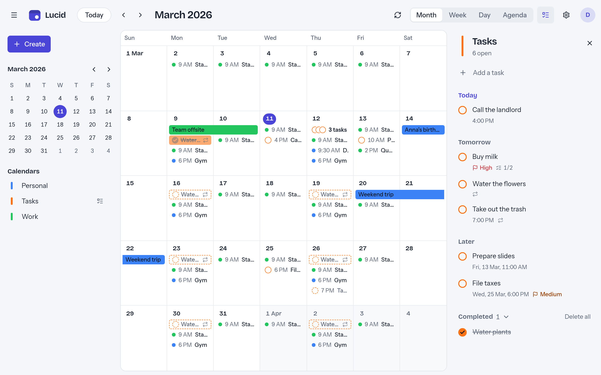
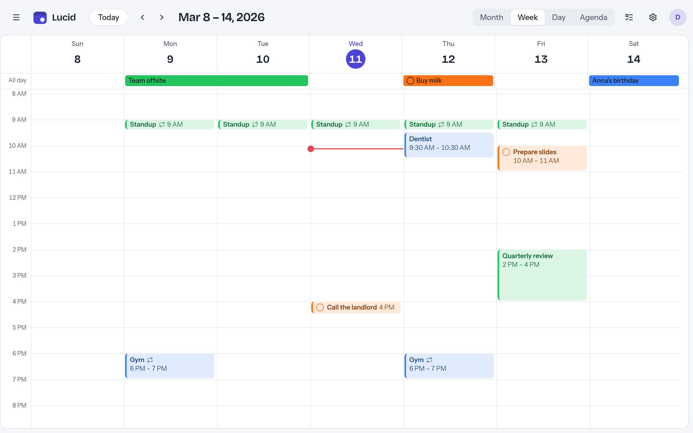
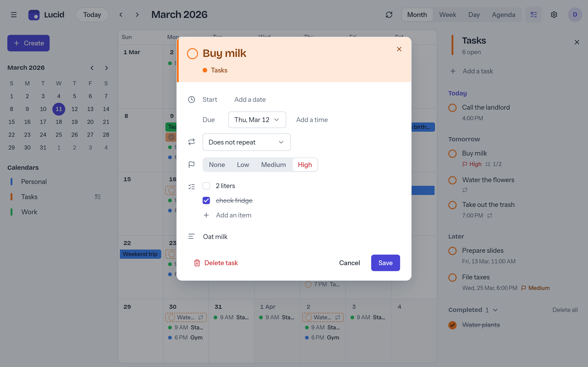
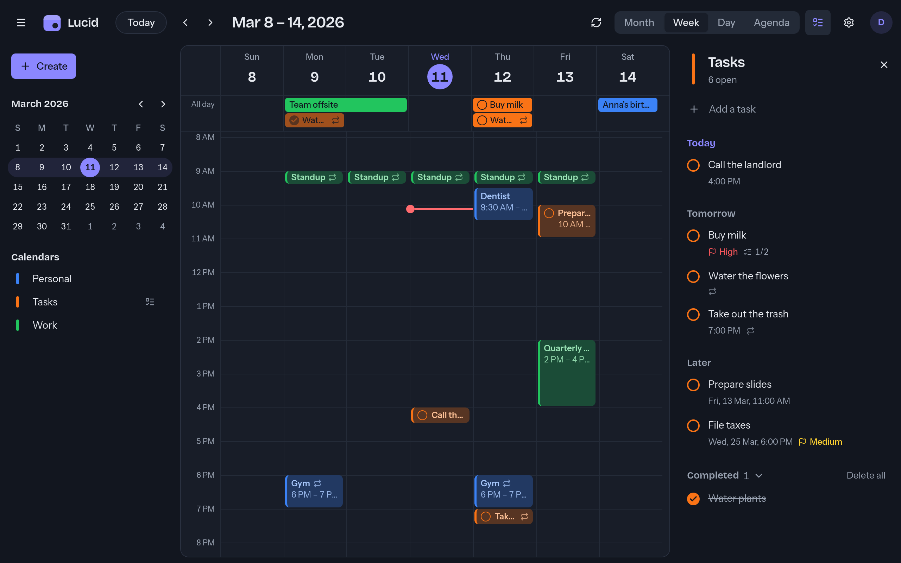
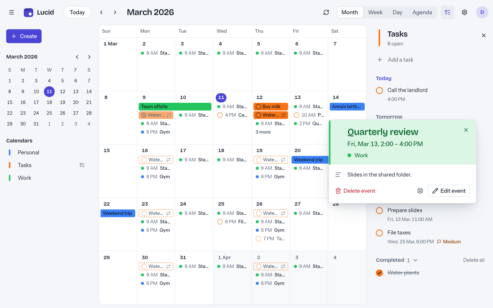
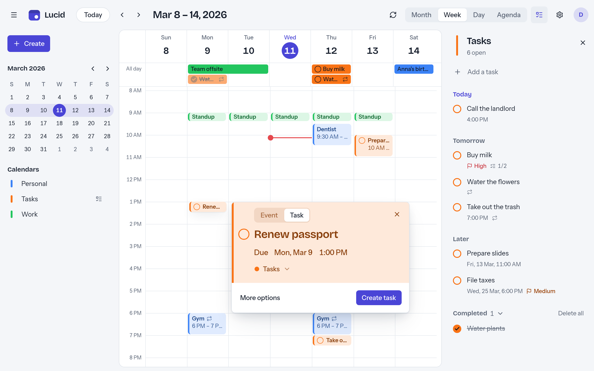
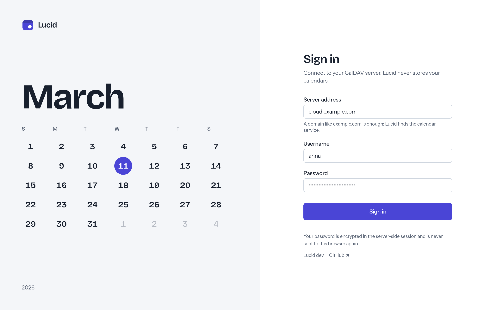
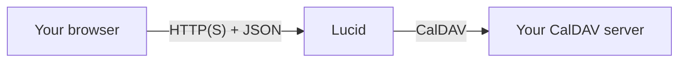

<p align="center">
  
</p>

<h1 align="center">Lucid</h1>

<p align="center">
  <strong>Self-hostable web client for your CalDAV calendars and tasks that actually looks good.</strong><br>
  Works with Nextcloud, Synology, Radicale, Baïkal, iCloud and more.
</p>

<p align="center">
  <a href="https://github.com/tbckr/lucid/actions/workflows/ci.yml"></a>
  <a href="https://github.com/tbckr/lucid/actions/workflows/codeql.yml"></a>
  <a href="LICENSE"></a>
</p>

<p align="center">
  <a href="#features">Features</a> ·
  <a href="#quick-start">Quick start</a> ·
  <a href="#configuration">Configuration</a> ·
  <a href="#security">Security</a> ·
  <a href="#contributing">Contributing</a>
</p>

Lucid gives the CalDAV server you already have a calendar you enjoy opening:
the views and drag & drop you know from Google Calendar, tasks with
checklists, light and dark mode. Your data stays where it is. There is nothing
to migrate and no database to run, just a single binary or container in front
of your server.

Lucid is also a contribution to [DI.DAY](https://di.day), the Digital
Independence Day, which invites you to swap one Big Tech service for a
privacy-friendly alternative on the first Sunday of every month. Your calendar
can be one of them: move it to your own CalDAV server or a provider you trust,
and Lucid keeps the comfort you're used to from Google Calendar.

<p align="center">
  
</p>

## Features

- **Calendar views:** month, week, day and agenda, with a color and a
  show/hide toggle for every calendar.
- **Drag & drop:** move events and tasks and resize events right in the
  calendar, a new one too while you are still naming it; changes show up
  instantly.
- **Tasks:** a task sidebar that groups each list by when its tasks are due,
  with checklists, start and due dates, priorities, repeats and completion.
  Rename a task or move it to another day right in the list, and delete done
  tasks one by one or all at once. Tasks with a date also appear in the
  calendar views, repeating ones at every repeat, where you can check them off
  or hide them once they're done. Checklists are saved as plain Markdown task
  lines, so your other apps can still read them.
- **Recurring events and time zones:** recurring series, all-day and timed
  events, always shown in your local time zone.
- **Custom repeats:** beyond daily, weekly, monthly and yearly, the repeat
  editor builds repeats of events and tasks such as "every 2 weeks on Monday
  and Thursday" or "every month on the last weekday", with an end date or a
  number of times. It shows the repeat as a sentence and lists its next
  dates; everywhere else, repeats are shown in words too.
- **Easy login:** enter just your domain; Lucid finds the CalDAV endpoint via
  `/.well-known/caldav` and DNS SRV records.
- **Fast:** repeated requests are answered from a short-lived cache that
  checks your server for changes. Changed something on your phone? Refresh
  with a click or `r` to see it right away.
- **Yours to adjust:** light and dark mode, English and German, date and time
  formats that follow your locale or your own choice in the settings.
- **Keyboard friendly:** shortcuts and full keyboard navigation (WCAG 2.1 AA
  target).
- **Easy to run:** download it and double-click on your own computer, or run
  a single static binary, a distroless container or a NixOS module on a
  server, with JSON logs, Prometheus metrics and health endpoints. NixOS and
  Home Manager modules cover both.

## Screenshots

<table>
  <tr>
    <td></td>
    <td></td>
  </tr>
  <tr>
    <td align="center">Tasks right in the calendar</td>
    <td align="center">Tasks with checklists</td>
  </tr>
  <tr>
    <td></td>
    <td></td>
  </tr>
  <tr>
    <td align="center">Week view in dark mode</td>
    <td align="center">Event details</td>
  </tr>
  <tr>
    <td></td>
    <td></td>
  </tr>
  <tr>
    <td align="center">Create an event or a task with a click</td>
    <td align="center">Sign in with just your domain</td>
  </tr>
</table>

## How it works



Lucid is a *smart proxy*: a single Go binary with the web app embedded. It
talks JSON to your browser and CalDAV to your server. Your CalDAV server stays
the single source of truth; Lucid only keeps sessions and a short-lived cache
in memory. After login, your browser holds nothing but a session cookie, never
your CalDAV credentials.

### Repeating tasks

A repeating task shows up at every repeat in the calendar views. Checking off
the current repeat moves the task on to its next one and leaves the done one
behind as a completed entry of its own. Repeats are checked off in order.
Where there is a choice, a change of a repeat asks which repeats it reaches:
only the current one, this one and the following ones, or all of them. Apple
Reminders and Tasks.org roll a repeating task forward the same way, so they
see what you did in Lucid, and Lucid reads what Thunderbird, KDE and others
write.
[docs/RECURRING-TASKS.md](docs/RECURRING-TASKS.md) explains why, with a survey
of how CalDAV clients handle repeating tasks.

## Quick start

### On your own computer

You need nothing but a CalDAV account: no server, no TLS, no configuration.

1. Download the archive for your system from the
   [releases page](https://github.com/tbckr/lucid/releases) and extract it.
   Its name ends in your system and processor, like
   `lucid_X.Y.Z_darwin_arm64.tar.gz`:
   - **Windows:** `windows_amd64.zip` for most PCs, `windows_arm64.zip` for ARM
     devices such as Snapdragon laptops.
   - **macOS** (called `darwin`): `darwin_arm64.tar.gz` for Apple silicon (M1
     and later), `darwin_amd64.tar.gz` for Intel Macs.
   - **Linux:** `linux_amd64.tar.gz` for most PCs, `linux_arm64.tar.gz` for ARM
     machines such as a Raspberry Pi 4 or 5 with a 64-bit OS.
2. Double-click `lucid` (`lucid.exe` on Windows).
3. A window opens and your browser shows Lucid at <http://127.0.0.1:3456/>.
   Log in with your CalDAV server's address (a bare domain is enough), your
   username and your password.

Close the window to stop Lucid. Closing the browser tab does not stop it.

- **macOS:** Gatekeeper blocks apps that are not signed by an Apple
  developer, and Lucid is not. Open System Settings, go to Privacy & Security
  and click "Open Anyway" next to the message about `lucid`.
- **Windows:** SmartScreen warns about the same. Click "More info", then "Run
  anyway".
- **Linux:** run `./lucid` in a terminal. Ctrl+C stops it.

This mode is meant for your own computer. Lucid listens on `127.0.0.1` only, so
no other device can reach it, and it serves plain HTTP because the traffic never
leaves your machine. Do not use it on a computer shared with people you do not
trust. CalDAV servers on your own computer or network (a Radicale on your NAS,
for example) work without further setup. To use Lucid from other devices, run
it on a server (below).

You log in again after each start, because sessions live in memory only. If
port 3456 is taken, Lucid says so and exits (on Windows the window stays open
until you press Enter). To choose another port, set `LUCID_LOCAL_PORT` in a
terminal, for example `LUCID_LOCAL_PORT=4000 ./lucid` on Linux and macOS, or
`$env:LUCID_LOCAL_PORT = "4000"; .\lucid.exe` in Windows PowerShell.

### On a server

> [!IMPORTANT]
> **TLS is mandatory on a server.** Lucid sets `Secure` session cookies and
> handles your CalDAV credentials. Run it behind a TLS-terminating reverse
> proxy (Caddy, Traefik, nginx, ...) or let it serve HTTPS itself via
> `LUCID_TLS_CERT` / `LUCID_TLS_KEY`.

Setting `LUCID_ADDR` makes Lucid a server (the container image and
`compose.yaml` set it for you, the Nix modules with `mode = "server"`); without
it, Lucid runs in local mode.

#### Docker Compose (recommended)

The repository contains a hardened example [`compose.yaml`](compose.yaml)
(read-only root filesystem, all capabilities dropped, non-root user,
`no-new-privileges`), bound to `127.0.0.1:8080` for your reverse proxy:

```sh
curl -fsSLO https://raw.githubusercontent.com/tbckr/lucid/main/compose.yaml
docker compose up -d
```

Minimal Caddy configuration:

```caddyfile
calendar.example.com {
	reverse_proxy 127.0.0.1:8080
}
```

Then open Lucid and log in with your CalDAV server's address (a bare domain is
enough), your username and your password.

<details>
<summary><strong>Docker</strong></summary>

```sh
docker run -d --name lucid \
  -p 127.0.0.1:8080:8080 \
  --read-only --cap-drop ALL --security-opt no-new-privileges:true \
  ghcr.io/tbckr/lucid:latest
```

Images are published for `linux/amd64` and `linux/arm64`, based on
`gcr.io/distroless/static` and running as UID/GID `65532`.

</details>

<details>
<summary><strong>Binary</strong></summary>

Download the archive for your platform from the
[releases page](https://github.com/tbckr/lucid/releases)
(Linux, macOS, Windows; amd64 and arm64), verify it (see
[Verifying releases](SECURITY.md#verifying-releases)) and run:

```sh
LUCID_ADDR=127.0.0.1:8080 ./lucid
./lucid --version
```

Health endpoints: `GET /healthz` (liveness), `GET /readyz` (readiness).
`lucid healthcheck` probes the local instance and exits non-zero on failure
(used by the container `HEALTHCHECK`, since distroless has no shell or curl).

</details>

### With Nix

The repository is a Nix flake with the package, an overlay, a NixOS module
and a Home Manager module. Both modules have the same options under
`services.lucid`, one for each variable in [Configuration](#configuration),
and run Lucid in local mode unless you set `mode = "server"`. Setting an
option of the other mode is an error when the configuration is evaluated. To
try Lucid without installing it: `nix run github:tbckr/lucid` (local mode).

<details>
<summary><strong>NixOS</strong></summary>

`services.lucid` runs Lucid as a hardened systemd service with a dynamic user,
started at boot:

```nix
{
  inputs.lucid.url = "github:tbckr/lucid";

  outputs =
    { nixpkgs, lucid, ... }:
    {
      nixosConfigurations.myhost = nixpkgs.lib.nixosSystem {
        system = "x86_64-linux";
        modules = [
          lucid.nixosModules.default
          { services.lucid.enable = true; }
        ];
      };
    };
}
```

**On your own computer** (local mode, the default), Lucid listens on
`127.0.0.1:3456` (`port` changes it). Open <http://127.0.0.1:3456/> or the
"Lucid" entry in your app menu. One instance serves every user of the
computer, each with their own CalDAV account.

**On a server behind a reverse proxy**, any proxy works; Lucid only needs to
know that one is in front of it:

```nix
services.lucid = {
  enable = true;
  mode = "server"; # listens on 127.0.0.1:8080
  trustProxyHeaders = true;
};

# nginx (with security.acme set up) ...
services.nginx.virtualHosts."calendar.example.com" = {
  forceSSL = true;
  enableACME = true;
  locations."/".proxyPass = "http://127.0.0.1:8080";
};

# ... or Caddy
services.caddy.virtualHosts."calendar.example.com".extraConfig = ''
  reverse_proxy 127.0.0.1:8080
'';
```

**On a server with its own TLS**, the certificate and key can come from any
source (ACME, agenix, sops-nix, plain files). systemd reads them and hands
them to Lucid as credentials, so the service needs no access to the files,
and they never enter the Nix store:

```nix
services.lucid = {
  enable = true;
  mode = "server";
  address = "0.0.0.0";
  port = 443;
  openFirewall = true;
  tls.certFile = "/var/lib/acme/calendar.example.com/fullchain.pem";
  tls.keyFile = "/var/lib/acme/calendar.example.com/key.pem";
};
# If security.acme manages the certificate: restart Lucid on renewal.
security.acme.certs."calendar.example.com".reloadServices = [ "lucid.service" ];
```

Lucid reads the certificate only when it starts, so a renewal restarts it, and
everyone logs in again (sessions live in memory). A port below 1024 gives the
service `CAP_NET_BIND_SERVICE` and turns off `PrivateUsers`; everything else
stays as restricted as with a higher port.

</details>

<details>
<summary><strong>Home Manager (Linux and macOS)</strong></summary>

For computers without NixOS or without root: `lucid.homeModules.default` runs
Lucid under your own user, as a systemd user service on Linux and a launchd
agent on macOS, started when you log in:

```nix
home-manager.lib.homeManagerConfiguration {
  # pkgs = ...;
  modules = [
    lucid.homeModules.default
    { services.lucid.enable = true; }
  ];
}
```

With Home Manager as a NixOS or nix-darwin module, add it with
`home-manager.sharedModules = [ lucid.homeModules.default ];`. The options are
those of the NixOS module, without `openFirewall`.

- In local mode, open <http://127.0.0.1:3456/>; on Linux there is also a
  "Lucid" entry in the app menu. Two users of one computer need different
  `port`s.
- Logs: `journalctl --user -u lucid` on Linux, `~/Library/Logs/lucid.log` on
  macOS.
- A user service on Linux starts at login. To start it at boot, for example
  for server mode, run `loginctl enable-linger <user>` once.
- A Linux user service cannot listen on a port below 1024; use a reverse proxy
  or a higher port.
- On macOS, Lucid reads `tls.certFile` and `tls.keyFile` itself, so your user
  must be able to read them. On Linux systemd hands them over.

</details>

## Configuration

Lucid is configured exclusively through environment variables; there are no
secrets in the configuration (the session key is random per start, the TLS key
is a file).

Lucid runs in **local mode** when `LUCID_ADDR` is unset and in **server mode**
when it is set. The Mode column says which mode a variable belongs to. A
variable set for the other mode (even to its default value), or one of the
variables of earlier versions that no longer exist, stops Lucid at startup with
a message that names the variable. For a variable of the other mode it says
which mode that is, for a removed one what replaces it or why it is gone.

<details>
<summary><strong>All environment variables</strong></summary>

| Variable | Mode | Default | Description |
|----------|------|---------|-------------|
| `LUCID_ADDR` | Server | (unset) | Listen address, e.g. `:8080`. Setting it selects server mode; unset runs local mode |
| `LUCID_LOCAL_PORT` | Local | `3456` | Port on `127.0.0.1`. The only port Lucid tries: if it is taken, Lucid exits |
| `LUCID_OPEN_BROWSER` | Local | `true` | Open the browser at Lucid's address once it is listening. `false` for development, tests and headless machines |
| `LUCID_METRICS_ADDR` | Server | (unset) | Address of a separate listener that serves `/metrics`. Unset: no `/metrics` at all |
| `LUCID_TLS_CERT`, `LUCID_TLS_KEY` | Server | (unset) | Paths of the certificate and key files, both or neither. Serves HTTPS directly. Otherwise TLS must be terminated by a reverse proxy |
| `LUCID_TRUST_PROXY_HEADERS` | Server | `false` | Use `X-Forwarded-For` for the client IP (only behind a trusted proxy) |
| `LUCID_PRIVATE_NETWORKS` | Both | local `all`, server `none` | Internal addresses (loopback, private, link-local, ...) that CalDAV servers may have: `all` allows every one, `none` none, and a comma-separated list of CIDRs and addresses (e.g. `192.168.1.10/32`) only those. `all` and `none` are case-insensitive and cannot be mixed with addresses |
| `LUCID_SESSION_TTL` | Both | `12h` | Absolute session lifetime |
| `LUCID_SESSION_IDLE_TIMEOUT` | Both | `2h` | Idle timeout, at most `LUCID_SESSION_TTL` |
| `LUCID_RATE_LIMIT_RPS` | Both | `20` | Token bucket refill per client IP (API) |
| `LUCID_RATE_LIMIT_BURST` | Both | `60` | Token bucket size |
| `LUCID_LOGIN_RATE_LIMIT_PER_MIN` | Both | `10` | Login attempts per client IP per minute |
| `LUCID_CACHE_SIZE` | Both | `256` | Cached entries (LRU), one per user, calendar and component (events or tasks) |
| `LUCID_CACHE_FRESHNESS` | Both | `10s` | Serve cache without CTag check for this long |
| `LUCID_UPSTREAM_TIMEOUT` | Both | `20s` | Timeout for requests to CalDAV servers |
| `LUCID_LOG_LEVEL` | Both | `info` | `debug`, `info`, `warn`, `error`. Logs go to stdout: text in local mode (which logs each request only at `debug`), JSON in server mode |

Durations use Go syntax (`90s`, `15m`, `12h`).

</details>

The REST API is documented in [docs/API.md](docs/API.md).

### Reverse proxy notes

- Terminate TLS at the proxy and forward plain HTTP to Lucid on a private
  interface (e.g. `127.0.0.1:8080`). Never expose the plain-HTTP port publicly.
- Set `LUCID_TRUST_PROXY_HEADERS=true` **only** if Lucid is reachable
  exclusively through the proxy; otherwise clients can spoof
  `X-Forwarded-For` and evade rate limiting.
- If your CalDAV server runs on your LAN, allow it narrowly with a CIDR in
  `LUCID_PRIVATE_NETWORKS` (e.g. `192.168.1.10/32`) rather than `all`.
- `/metrics` is served only on the separate address `LUCID_METRICS_ADDR`, never
  on the main listener. Keep that address internal; without it there are no
  metrics.

## Security

- **Proxy architecture.** The browser only talks to Lucid; Lucid talks to the
  CalDAV server. This avoids CORS problems and keeps CalDAV credentials out of
  the browser: after login the frontend only holds an opaque session cookie
  (`HttpOnly`, `SameSite=Strict`, and `Secure` in server mode; local mode
  serves plain HTTP on the loopback interface only and sets no `Secure` flag).
- **Encrypted in-memory sessions.** Credentials are stored server-side,
  encrypted with AES-256-GCM under a key that is random per start, and only in
  RAM. Nothing is written to disk, and no key appears in the environment or the
  configuration.
- **Local mode.** It listens on `127.0.0.1` only and accepts requests only
  when the `Host` header is `localhost` or `127.0.0.1` (any port), which
  protects against DNS rebinding. It is meant for your own computer: other
  users of that computer can reach the same address.
- **SSRF protection.** Because users choose the server URL, every outgoing
  request (including auto-discovery and redirects) goes through a safe
  transport that refuses loopback, private, link-local and other internal
  address ranges unless `LUCID_PRIVATE_NETWORKS` allows them. Local mode allows
  them all by default, because you can reach your own network anyway; server
  mode allows none.
- **Web hardening.** CSRF synchronizer tokens on all state-changing requests,
  token-bucket rate limiting (stricter for login), strict security headers
  (CSP, HSTS, `X-Frame-Options`, `X-Content-Type-Options`), XML entity
  protection, input validation, open-redirect protection, no source maps in
  production builds.
- **Supply chain.** Signed releases and images, SBOMs and daily vulnerability
  scans; see [Supply chain](SECURITY.md#supply-chain).

> [!NOTE]
> **Known limitation:** sessions live only in memory, so restarting Lucid logs
> everybody out.

To report a vulnerability, see [SECURITY.md](SECURITY.md).

## Contributing

Bug reports, feature ideas and pull requests are welcome.
[CONTRIBUTING.md](CONTRIBUTING.md) explains the development setup
(`just dev` starts Lucid with a demo CalDAV server) and the project's
conventions.

## License

Lucid is free software licensed under the
[GNU General Public License v3.0](LICENSE).
